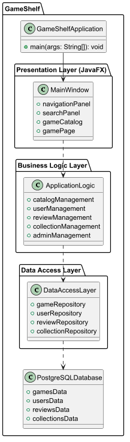
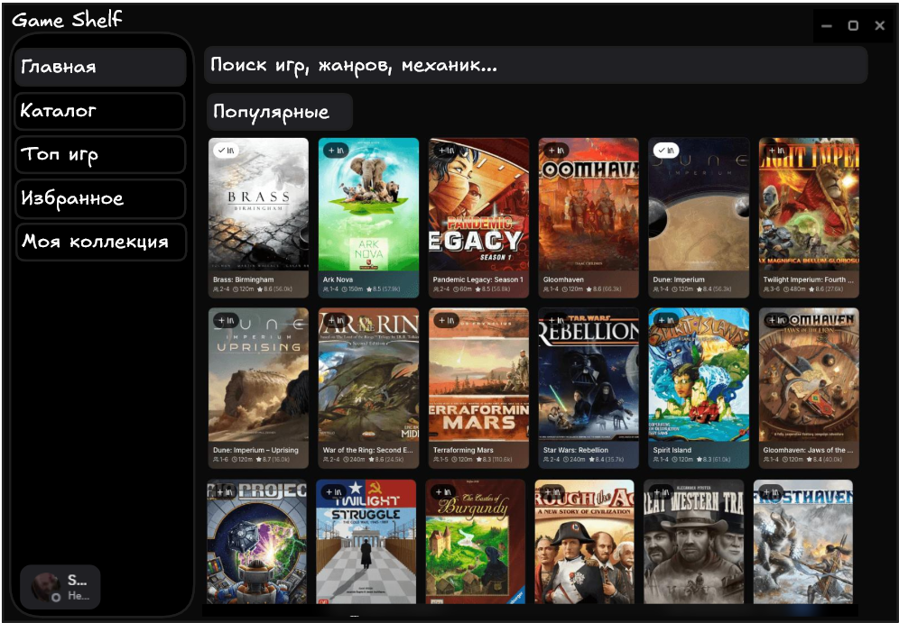

# Спецификация требований к ПО

**Проект:** GameShelf  
**Версия:** 0.1  
**Подготовил(а):** Владыковский Н. Д. 
**Организация:** БГУИР, ФКСиС, группа 450504
**Дата изменения:** 05.11.2026

## Оглавление

- [1. Введение](#1-введение)
  - [1.1 Назначение документа](#11-назначение-документа)
  - [1.2 Область применения продукта](#12-область-применения-продукта)
  - [1.3 Определения, акронимы и сокращения](#13-определения-акронимы-и-сокращения)
  - [1.4 Ссылки](#14-ссылки)
  - [1.5 Обзор документа](#15-обзор-документа)
- [2. Обзор продукта](#2-обзор-продукта)
  - [2.1 Перспектива продукта](#21-перспектива-продукта)
  - [2.2 Функции продукта](#22-функции-продукта)
  - [2.3 Ограничения продукта](#23-ограничения-продукта)
  - [2.4 Характеристики пользователей](#24-характеристики-пользователей)
  - [2.5 Допущения и зависимости](#25-допущения-и-зависимости)
  - [2.6 Распределение требований](#26-распределение-требований)
- [3. Требования](#3-требования)
  - [3.1 Внешние интерфейсы](#31-внешние-интерфейсы)
  - [3.2 Функциональные требования](#32-функциональные-требования)
  - [3.3 Качество обслуживания](#33-качество-обслуживания)
  - [3.4 Соответствие стандартам](#34-соответствие-стандартам)
  - [3.5 Проектирование и реализация](#35-проектирование-и-реализация)
  - [3.6 ИИ/МО](#36-ии-мо)
- [4. Верификация](#4-верификация)
- [5. Приложения](#5-приложения)

---

## История изменений

| Name | Date | Reason For Changes | Version |
|------|------|--------------------|---------|
| Владыковский Н.Д. | 05.11.2026 | создание первоначальной спецификации требований | 0.1 |
| Владыковский Н.Д. | 05.11.2026 | добавленны ссылки на изображения | 0.2 |
| Кожин М.М. | 06.11.2026 | исправление ссылки на изображения | 0.3 |

---

## 1. Введение

Данный документ представляет собой спецификацию требований к программному обеспечению GameShelf. В нём определяются назначение приложения, его функциональные возможности, ограничения, требования к качеству и способы проверки соответствия разработанной системы установленным требованиям.

Документ предназначен для участников проекта, включая заказчика, менеджера проекта, разработчиков и специалистов, отвечающих за тестирование программного обеспечения.

### 1.1 Назначение документа

Назначение данного документа — определить требования к desktop-приложению GameShelf, предназначенному для просмотра каталога настольных игр, поиска информации о них и взаимодействия пользователей с игровым сообществом.

Спецификация описывает, **что должна делать система**, а не конкретные способы реализации её функций. Документ используется в качестве основы для проектирования, разработки, тестирования и оценки готового программного продукта.

### 1.2 Область применения продукта

GameShelf версии 0.1 — настольное приложение для каталогизации, поиска и оценки настольных игр. Концепция продукта основана на принципах платформ IMDb и Metacritic, адаптированных для настольных игр.

Приложение предоставляет пользователям возможность просматривать каталог игр, искать их по названию, применять фильтры, знакомиться с характеристиками, выставлять оценки и оставлять отзывы. Зарегистрированные пользователи также могут формировать личные коллекции и добавлять игры в избранное.

В состав продукта входят:
- каталог настольных игр;
- поиск и фильтрация игр;
- просмотр подробной информации об играх;
- система пользовательских оценок и отзывов;
- регистрация и авторизация пользователей;
- управление избранным и личными коллекциями;
- административное управление каталогом.

В рамках текущей версии не предусматриваются онлайн-покупка настольных игр, проведение игровых сессий, общение в режиме реального времени и использование технологий искусственного интеллекта.

### 1.3 Определения, акронимы и сокращения

| Term | Definition |
|------|------------|
| API | Application Programming Interface — программный интерфейс приложения |
| CRUD | Create, Read, Update, Delete — основные операции создания, чтения, изменения и удаления данных |
| Desktop | тип приложения, предназначенный для запуска на персональном компьютере |
| FR | Functional Requirement — функциональное требование |
| GUI | Graphical User Interface — графический пользовательский интерфейс |
| JDBC | Java Database Connectivity — интерфейс Java для взаимодействия с базами данных |
| JPA | Java Persistence API — спецификация для управления сохранением объектов Java |
| NFR | Non-Functional Requirement — нефункциональное требование |
| PostgreSQL | реляционная система управления базами данных с открытым исходным кодом |
| SRS | Software Requirements Specification — спецификация требований к программному обеспечению |
| UI | User Interface — пользовательский интерфейс |
| JavaFX | библиотека Java для создания графических пользовательских интерфейсов |
| Пользователь | человек, использующий приложение GameShelf |
| Администратор | пользователь с расширенными правами для управления каталогом настольных игр |
| Настольная игра | объект каталога GameShelf, содержащий название, описание и характеристики игры |

### 1.4 Ссылки

| Документ или ресурс | Назначение | Тип |
|---------------------|-----------|-----|
| `srs/srs-template.md` | шаблон спецификации требований | нормативный |
| репозиторий лабораторной работы № 2 | хранение исходных материалов проекта | справочный |
| Java Documentation | официальная документация языка Java | справочный |
| JavaFX Documentation | документация технологии JavaFX | справочный |
| PostgreSQL Documentation | документация системы управления базами данных PostgreSQL | справочный |
| SysML v2 Documentation | документация языка системного моделирования SysML v2 | справочный |

### 1.5 Обзор документа

Документ состоит из пяти основных разделов. В первом разделе определяются назначение, область применения и терминология проекта. Во втором разделе описываются концепция продукта, его функции, ограничения, пользователи и зависимости. Третий раздел содержит подробные функциональные и нефункциональные требования, а также требования к интерфейсам и реализации. Четвёртый раздел определяет способы проверки соответствия системы требованиям, пятый содержит дополнительные материалы и диаграммы.

Изменения спецификации фиксируются в таблице истории изменений с указанием автора, даты, причины и версии документа.

---

## 2. Обзор продукта

### 2.1 Перспектива продукта

GameShelf является самостоятельным desktop-приложением, разрабатываемым в рамках учебного проекта. Продукт предназначен для объединения информации о настольных играх в едином каталоге и предоставления пользователям инструментов для оценки и систематизации игр.

Приложение не является частью существующей информационной системы и не предполагает обязательной интеграции с внешними сервисами. Основным хранилищем информации выступает база данных PostgreSQL.

Архитектура приложения предусматривает разделение на три логических слоя:

1. **Presentation Layer** — отвечает за графический интерфейс и взаимодействие с пользователем. Для реализации используется JavaFX.
2. **Business Logic Layer** — содержит бизнес-логику приложения: управление каталогом, пользователями, оценками, отзывами и коллекциями.
3. **Data Access Layer** — обеспечивает взаимодействие с базой данных PostgreSQL посредством JDBC или JPA.

Общая структура приложения представлена на концептуальной диаграмме архитектуры GameShelf.

### 2.2 Функции продукта

GameShelf предоставляет следующие основные возможности:

- просмотр каталога настольных игр с отображением основной информации;
- поиск игр по названию;
- фильтрация каталога по жанру, количеству игроков и рейтингу;
- просмотр подробной страницы выбранной игры;
- выставление пользовательских оценок;
- добавление и просмотр текстовых отзывов;
- регистрация и авторизация пользователей;
- добавление игр в избранное и личные коллекции;
- сортировка каталога по рейтингу и популярности;
- добавление и редактирование карточек игр администратором.

### 2.3 Ограничения продукта

При разработке GameShelf необходимо учитывать следующие ограничения:

- приложение должно разрабатываться как desktop-программа;
- основным языком программирования должен быть Java;
- для создания графического интерфейса должна использоваться JavaFX;
- для хранения данных должна использоваться СУБД PostgreSQL;
- архитектура приложения должна предусматривать разделение пользовательского интерфейса, бизнес-логики и доступа к данным;
- взаимодействие с базой данных должно осуществляться через отдельный слой доступа к данным;
- пароли пользователей не должны храниться в открытом виде;
- доступ к административным функциям должен предоставляться только авторизованным пользователям с соответствующими правами.

В текущей версии не предусматривается разработка мобильного или веб-клиента.

### 2.4 Характеристики пользователей

В системе предусмотрены две основные категории пользователей.

**Обычный пользователь:**

- использует приложение для поиска и просмотра настольных игр;
- может просматривать характеристики, оценки и отзывы;
- может зарегистрироваться и авторизоваться;
- после авторизации может выставлять оценки, оставлять отзывы, добавлять игры в избранное и формировать личные коллекции;
- не имеет доступа к административным функциям.

**Администратор:**

- обладает возможностями обычного пользователя;
- имеет доступ к управлению каталогом настольных игр;
- может добавлять новые карточки игр;
- может редактировать существующие карточки игр;
- отвечает за актуальность и корректность информации в каталоге.

Предполагается, что пользователи обладают базовыми навыками работы с персональным компьютером и графическими приложениями.

### 2.5 Допущения и зависимости

При разработке продукта принимаются следующие допущения:

- пользователи имеют персональный компьютер, соответствующий требованиям для запуска Java-приложений;
- в системе установлена необходимая среда выполнения Java;
- база данных PostgreSQL доступна приложению во время выполнения операций с данными;
- информация о настольных играх добавляется и поддерживается администраторами;
- пользователи самостоятельно предоставляют данные, необходимые для регистрации;
- для полноценной работы приложения необходимо стабильное соединение с базой данных.

Основные зависимости проекта:

- Java Development Kit — для разработки и запуска приложения;
- JavaFX — для построения графического интерфейса;
- PostgreSQL — для хранения информации;
- JDBC или JPA — для взаимодействия с базой данных.

При недоступности базы данных операции, требующие чтения или изменения данных, могут быть временно недоступны. Приложение должно корректно сообщать пользователю о возникшей ошибке.

### 2.6 Распределение требований

Требования распределяются по основным компонентам приложения следующим образом:

| Компонент | Реализуемые требования |
|-----------|------------------------|
| Presentation Layer | пользовательский интерфейс, каталог, поиск, фильтры, страницы игр, формы регистрации и авторизации |
| Business Logic Layer | поиск и фильтрация, управление пользователями, оценки, отзывы, избранное, коллекции, административные операции |
| Data Access Layer | получение, добавление, изменение и удаление данных, взаимодействие с PostgreSQL |
| PostgreSQL Database | хранение информации об играх, пользователях, оценках, отзывах и коллекциях |

Все перечисленные функции относятся к планируемой версии 0.1. Разделение реализации на отдельные итерации может быть уточнено в ходе разработки.

---

## 3. Требования

### 3.1 Внешние интерфейсы

#### 3.1.1 Пользовательские интерфейсы

Приложение должно предоставлять графический пользовательский интерфейс, реализованный с использованием JavaFX.

Основные элементы интерфейса:

- главное окно приложения;
- панель навигации между основными разделами;
- каталог настольных игр;
- строка поиска;
- элементы фильтрации и сортировки;
- карточки настольных игр;
- подробная страница выбранной игры;
- формы регистрации и авторизации;
- формы добавления оценок и отзывов;
- раздел избранного и личных коллекций;
- административный интерфейс управления каталогом.

Интерфейс должен обеспечивать понятную навигацию между разделами и отображать сообщения об ошибках при некорректном вводе или невозможности выполнения операции.

Графические макеты интерфейса представлены в PNG-файлах, расположенных в репозитории проекта.

#### 3.1.2 Аппаратные интерфейсы

Специальные аппаратные интерфейсы для работы GameShelf не предусмотрены.

Для запуска приложения необходим персональный компьютер, поддерживающий работу Java и JavaFX. Отдельные устройства или специализированное оборудование не требуются.

#### 3.1.3 Программные интерфейсы

Приложение должно взаимодействовать со следующими программными компонентами:

| Компонент | Назначение |
|-----------|-----------|
| Java | основной язык программирования и среда разработки |
| JavaFX | создание графического пользовательского интерфейса |
| PostgreSQL | хранение данных приложения |
| JDBC или JPA | взаимодействие с базой данных |

Взаимодействие с PostgreSQL должно осуществляться через Data Access Layer. Доступ к данным должен выполняться с использованием соответствующих механизмов подключения и обработки ошибок.

Интеграция со сторонними API и внешними сервисами в текущей версии не предусмотрена.

### 3.2 Функциональные требования

#### FR-01. Просмотр каталога настольных игр

- **ID:** `REQ-FUNC-001`
- **Title:** просмотр каталога настольных игр.
- **Statement:** система должна предоставлять пользователю возможность просматривать каталог настольных игр с отображением их основных характеристик.
- **Rationale:** каталог является основным способом знакомства пользователя с доступными играми.
- **Acceptance Criteria:** при открытии раздела каталога система отображает список доступных игр. Для каждой игры отображается её название и основная информация.
- **Verification Method:** Test.
- **More Information:** интерфейс каталога.

#### FR-02. Поиск игр по названию

- **ID:** `REQ-FUNC-002`
- **Title:** поиск настольных игр.
- **Statement:** система должна предоставлять возможность поиска настольных игр по названию.
- **Rationale:** поиск позволяет пользователю быстро находить интересующие его игры.
- **Acceptance Criteria:** при вводе названия или его части система отображает соответствующие результаты. При отсутствии совпадений система сообщает, что игры не найдены.
- **Verification Method:** Test.
- **More Information:** строка поиска в каталоге.

#### FR-03. Фильтрация каталога

- **ID:** `REQ-FUNC-003`
- **Title:** фильтрация настольных игр.
- **Statement:** система должна предоставлять возможность фильтрации каталога по жанру, количеству игроков и пользовательскому рейтингу.
- **Rationale:** фильтрация помогает пользователю выбирать игры по интересующим характеристикам.
- **Acceptance Criteria:** пользователь может задать один или несколько фильтров. Система отображает игры, соответствующие выбранным условиям.
- **Verification Method:** Test.
- **More Information:** панель фильтров каталога.

#### FR-04. Просмотр страницы игры

- **ID:** `REQ-FUNC-004`
- **Title:** просмотр подробной информации об игре.
- **Statement:** система должна предоставлять отдельную страницу для каждой настольной игры с подробным описанием и характеристиками.
- **Rationale:** пользователю необходима полная информация об игре перед принятием решения о её добавлении в коллекцию или выставлении оценки.
- **Acceptance Criteria:** при выборе игры открывается её страница с названием, описанием и доступными характеристиками.
- **Verification Method:** Test.
- **More Information:** страница настольной игры.

#### FR-05. Выставление пользовательских оценок

- **ID:** `REQ-FUNC-005`
- **Title:** выставление оценок.
- **Statement:** система должна предоставлять авторизованным пользователям возможность выставлять оценки настольным играм.
- **Rationale:** пользовательские оценки позволяют формировать рейтинг игр на основе мнений сообщества.
- **Acceptance Criteria:** авторизованный пользователь может выставить оценку игре. Система сохраняет оценку и учитывает её при формировании пользовательского рейтинга. Неавторизованный пользователь не может выставлять оценки.
- **Verification Method:** Test.
- **More Information:** оценка игры и пользовательский рейтинг.

#### FR-06. Добавление и просмотр отзывов

- **ID:** `REQ-FUNC-006`
- **Title:** работа с отзывами.
- **Statement:** система должна предоставлять авторизованным пользователям возможность добавлять текстовые отзывы к настольным играм и просматривать существующие отзывы.
- **Rationale:** отзывы позволяют пользователям обмениваться мнениями и получать дополнительную информацию об играх.
- **Acceptance Criteria:** авторизованный пользователь может добавить текстовый отзыв. Система сохраняет его и отображает на странице соответствующей игры. Пользователи могут просматривать опубликованные отзывы.
- **Verification Method:** Test.
- **More Information:** раздел отзывов на странице игры.

#### FR-07. Регистрация и авторизация

- **ID:** `REQ-FUNC-007`
- **Title:** регистрация и авторизация пользователей.
- **Statement:** система должна предоставлять возможность регистрации новых пользователей и авторизации зарегистрированных пользователей.
- **Rationale:** регистрация и авторизация необходимы для идентификации пользователей и предоставления персональных функций.
- **Acceptance Criteria:** пользователь может создать учётную запись с использованием необходимых регистрационных данных. При вводе корректных учётных данных система предоставляет доступ к персональным функциям. При вводе неверных данных система сообщает об ошибке.
- **Verification Method:** Test.
- **More Information:** формы регистрации и авторизации.

#### FR-08. Избранное и личные коллекции

- **ID:** `REQ-FUNC-008`
- **Title:** управление личными коллекциями.
- **Statement:** система должна предоставлять авторизованным пользователям возможность добавлять настольные игры в избранное и личные коллекции, а также просматривать сохранённые игры.
- **Rationale:** данная функция позволяет пользователям систематизировать интересующие их настольные игры.
- **Acceptance Criteria:** авторизованный пользователь может добавить игру в избранное или коллекцию и просмотреть список сохранённых игр. Данные сохраняются между запусками приложения.
- **Verification Method:** Test.
- **More Information:** раздел избранного и личных коллекций.

#### FR-09. Сортировка каталога

- **ID:** `REQ-FUNC-009`
- **Title:** сортировка настольных игр.
- **Statement:** система должна предоставлять возможность сортировки каталога по пользовательскому рейтингу и популярности.
- **Rationale:** сортировка помогает находить наиболее высоко оценённые и востребованные игры.
- **Acceptance Criteria:** пользователь может выбрать критерий сортировки. Система отображает игры в соответствии с выбранным порядком.
- **Verification Method:** Test.
- **More Information:** элементы сортировки каталога.

#### FR-10. Администрирование каталога

- **ID:** `REQ-FUNC-010`
- **Title:** управление карточками настольных игр.
- **Statement:** система должна предоставлять администраторам возможность добавлять новые карточки настольных игр и редактировать существующие.
- **Rationale:** административные функции необходимы для поддержания актуальности и корректности каталога.
- **Acceptance Criteria:** пользователь с правами администратора может добавить новую игру и изменить информацию существующей игры. Обычный пользователь не имеет доступа к данным операциям.
- **Verification Method:** Test.
- **More Information:** административный интерфейс.

### 3.3 Качество обслуживания

#### 3.3.1 Производительность

- **ID:** `REQ-PERF-001`
- **Title:** время отклика интерфейса.
- **Statement:** система должна обеспечивать выполнение стандартных операций просмотра каталога, поиска и фильтрации без заметных задержек при нормальной нагрузке.
- **Rationale:** приемлемое время отклика необходимо для комфортного взаимодействия пользователя с приложением.
- **Acceptance Criteria:** при тестировании на согласованном оборудовании основные операции должны выполняться не более чем за 3 секунды при нормальной нагрузке и доступной базе данных.
- **Verification Method:** Test.
- **More Information:** целевое значение является предварительным и может быть уточнено.

#### 3.3.2 Безопасность

- **ID:** `REQ-SEC-001`
- **Title:** безопасное хранение паролей.
- **Statement:** система должна хранить пароли пользователей только в виде стойких криптографических хешей с использованием алгоритма, предназначенного для хранения паролей.
- **Rationale:** защита учётных данных пользователей от несанкционированного раскрытия.
- **Acceptance Criteria:** в базе данных отсутствуют пароли в открытом виде. Проверка пароля осуществляется посредством безопасного сравнения с сохранённым хешем.
- **Verification Method:** Inspection, Test.
- **More Information:** требования к регистрации и авторизации.

- **ID:** `REQ-SEC-002`
- **Title:** разграничение прав доступа.
- **Statement:** система должна разграничивать права обычных пользователей и администраторов.
- **Rationale:** административные операции должны быть доступны только уполномоченным пользователям.
- **Acceptance Criteria:** обычный пользователь не может добавлять или редактировать карточки игр через административные функции. Администратор имеет доступ к соответствующим операциям.
- **Verification Method:** Test.
- **More Information:** административные функции.

#### 3.3.3 Надёжность

- **ID:** `REQ-REL-001`
- **Title:** обработка ошибок.
- **Statement:** система должна обрабатывать ошибки ввода и проблемы взаимодействия с базой данных без аварийного завершения приложения.
- **Rationale:** корректная обработка ошибок обеспечивает стабильность работы программы.
- **Acceptance Criteria:** при возникновении ошибки система отображает соответствующее сообщение и сохраняет работоспособность, если дальнейшая работа возможна.
- **Verification Method:** Test.
- **More Information:** обработка исключений и ошибок подключения.

#### 3.3.4 Доступность

Специальные требования к круглосуточной доступности не устанавливаются, поскольку GameShelf является desktop-приложением учебного проекта.

Доступность приложения зависит от работоспособности персонального компьютера, среды выполнения Java и базы данных PostgreSQL.

#### 3.3.5 Наблюдаемость

- **ID:** `REQ-OBS-001`
- **Title:** регистрация ошибок приложения.
- **Statement:** система должна регистрировать основные ошибки приложения, включая ошибки подключения к базе данных и ошибки выполнения операций.
- **Rationale:** журналирование необходимо для диагностики проблем и сопровождения приложения.
- **Acceptance Criteria:** при возникновении критической ошибки соответствующая информация фиксируется в журнале приложения.
- **Verification Method:** Inspection, Test.
- **More Information:** механизм логирования приложения.

### 3.4 Соответствие стандартам

Разработка GameShelf должна учитывать следующие требования и рекомендации:

- код приложения должен соответствовать общепринятым соглашениям языка Java;
- структура проекта и исходный код должны поддерживать единообразное именование классов, методов и переменных;
- документация проекта должна быть оформлена в формате Markdown;
- требования к программному обеспечению должны быть сформулированы однозначно и допускать проверку;
- используемые библиотеки и компоненты должны иметь лицензии, допускающие их применение в учебном проекте.

Специальные отраслевые сертификаты и нормативные требования для текущей версии продукта не предусмотрены.

### 3.5 Проектирование и реализация

#### 3.5.1 Установка

GameShelf должно устанавливаться и запускаться на персональном компьютере с поддерживаемой операционной системой и установленной средой выполнения Java.

Для работы приложения необходимо обеспечить доступность базы данных PostgreSQL и корректность параметров подключения.

#### 3.5.2 Сборка и поставка

Исходный код приложения должен храниться в Git-репозитории проекта.

Сборка приложения должна выполняться с использованием выбранной системы сборки Java-проекта. Результатом сборки должен быть исполняемый артефакт, необходимый для запуска приложения.

Изменения исходного кода и документации должны фиксироваться отдельными коммитами.

#### 3.5.3 Распределение

В текущей версии GameShelf предусматривается запуск приложения на персональном компьютере пользователя.

База данных PostgreSQL может располагаться на том же компьютере или на отдельном доступном сервере. Конкретная схема размещения определяется конфигурацией проекта.

Распределённая архитектура с несколькими экземплярами приложения и репликацией базы данных не предусматривается.

#### 3.5.4 Сопровождаемость

Архитектура приложения должна обеспечивать разделение пользовательского интерфейса, бизнес-логики и доступа к данным.

Исходный код должен иметь понятную структуру и единообразное именование компонентов. Изменения в одной логической части приложения должны по возможности выполняться без необходимости существенной переработки остальных слоёв.

#### 3.5.5 Повторное использование

В приложении должны использоваться повторно применимые компоненты для типовых операций, таких как работа с базой данных, проверка пользовательского ввода и обработка ошибок.

Повторное использование компонентов должно обеспечиваться за счёт разделения ответственности между классами и модулями приложения.

#### 3.5.6 Переносимость

Приложение должно быть совместимо с операционными системами, поддерживающими используемую версию Java и JavaFX.

Возможность запуска на конкретной операционной системе зависит от используемой среды выполнения и настроек сборки.

#### 3.5.7 Стоимость

Проект разрабатывается в рамках учебной лабораторной работы. Отдельный бюджет на разработку не предусматривается.

При реализации предпочтительно использовать свободно распространяемые инструменты и библиотеки, не требующие приобретения коммерческих лицензий.

#### 3.5.8 Сроки

Разработка выполняется в рамках лабораторных работ по дисциплине ЖЦРПО.

Основные этапы включают:
- определение концепции и требований к продукту;
- разработку графических макетов;
- подготовку спецификации требований;
- реализацию приложения;
- проверку работоспособности и корректировку документации.

Конкретные сроки выполнения определяются учебным планом и требованиями преподавателя.

#### 3.5.9 Доказательство концепции

В рамках текущей версии отдельный Proof of Concept не предусматривается.

Техническая осуществимость выбранного стека проверяется в процессе разработки графического интерфейса, взаимодействия с PostgreSQL и реализации основных функций приложения.

#### 3.5.10 Управление изменениями

Изменения требований и исходного кода должны фиксироваться в Git-репозитории.

Для внесения изменений используется отдельная ветка. После завершения работы изменения могут быть предложены для проверки посредством Pull Request.

Изменения документации должны отражаться в истории изменений SRS с указанием версии, даты и причины корректировки.

### 3.6 ИИ/МО

Использование технологий искусственного интеллекта и машинного обучения в текущей версии GameShelf не предусмотрено.

Приложение использует обычные алгоритмы поиска, фильтрации и сортировки данных, а также вычисление пользовательского рейтинга на основе сохранённых оценок.

Подразделы 3.6.1–3.6.6 не применяются к текущей версии продукта.

---

## 4. Верификация

Проверка соответствия GameShelf установленным требованиям должна выполняться посредством функционального тестирования, анализа исходного кода и инспекции документации.

Для функциональных требований основным методом проверки является тестирование пользовательских сценариев. Для нефункциональных требований применяются тестирование производительности, проверка обработки ошибок и анализ реализации механизмов безопасности.

Предварительная матрица верификации:

| Requirement ID | Verification Method | Test/Artifact Link | Status | Evidence |
|----------------|---------------------|--------------------|--------|----------|
| REQ-FUNC-001 | Test | tests/catalog-test.md | Planned | — |
| REQ-FUNC-002 | Test | tests/search-test.md | Planned | — |
| REQ-FUNC-003 | Test | tests/filter-test.md | Planned | — |
| REQ-FUNC-004 | Test | tests/game-page-test.md | Planned | — |
| REQ-FUNC-005 | Test | tests/rating-test.md | Planned | — |
| REQ-FUNC-006 | Test | tests/review-test.md | Planned | — |
| REQ-FUNC-007 | Test | tests/auth-test.md | Planned | — |
| REQ-FUNC-008 | Test | tests/collection-test.md | Planned | — |
| REQ-FUNC-009 | Test | tests/sorting-test.md | Planned | — |
| REQ-FUNC-010 | Test | tests/admin-test.md | Planned | — |
| REQ-PERF-001 | Test | tests/performance-test.md | Planned | — |
| REQ-SEC-001 | Inspection, Test | tests/password-security-test.md | Planned | — |
| REQ-SEC-002 | Test | tests/access-control-test.md | Planned | — |
| REQ-REL-001 | Test | tests/error-handling-test.md | Planned | — |
| REQ-OBS-001 | Inspection, Test | tests/logging-test.md | Planned | — |

Статус `Planned` означает, что проверка запланирована, но ещё не выполнена. После реализации соответствующих функций статусы должны быть обновлены, а в столбце Evidence необходимо указать результаты проверки.

---

## 5. Приложения

К документу могут быть добавлены следующие материалы:

- концептуальная диаграмма архитектуры приложения GameShelf;
- графические макеты пользовательского интерфейса;
- диаграммы, подготовленные с использованием SysML v2;
- дополнительные схемы структуры базы данных;
- другие материалы, необходимые для понимания требований.

Графические макеты пользовательского интерфейса хранятся в репозитории проекта в формате PNG. Ссылки на соответствующие файлы должны быть доступны из раздела 3.1.1.

## Приложение А. Архитектура системы

## Приложение Б. Макеты пользовательского интерфейса

